  

 

### // stack

  frontend 
  &nbsp;
  &nbsp;
  &nbsp;
  &nbsp;
  

  backend 
  Node.js (339933, logo nodedotjs), Express (000000, logo express), NestJS (E0234E, logo nestjs)

  databases 
  MongoDB (47A248, logo mongodb), PostgreSQL (4169E1, logo postgresql)

  tools 
  Docker (2496ED, logo docker), Git (F05032, logo git), GitHub (181717, logo github), Postman (FF6C37, logo postman), Vercel (000000, logo vercel), AWS S3 (569A31, logo amazons3)

 
### // whoami

full-stack developer building real products with react, node.js and nestjs. i started in commerce, taught myself to code, and now freelance for real clients, including a project management platform for imam abdulrahman bin faisal university. my digilians graduation project, sanda, is a gig-work marketplace with escrow payments and qr attendance. always learning, always shipping.

### // currently

- building qasem market, a freelance e-commerce platform for a client in palestine
- freelancing on full-stack projects with react, node.js and nestjs
- learning jest and test automation

### // contact

[`hossamprofile.vercel.app`](https://hossamprofile.vercel.app) · [`linkedin/hossam-hassan-hefni`](https://www.linkedin.com/in/hossam-hassan-hefni) · [`hossam.h.dev@gmail.com`](mailto:hossam.h.dev@gmail.com)
